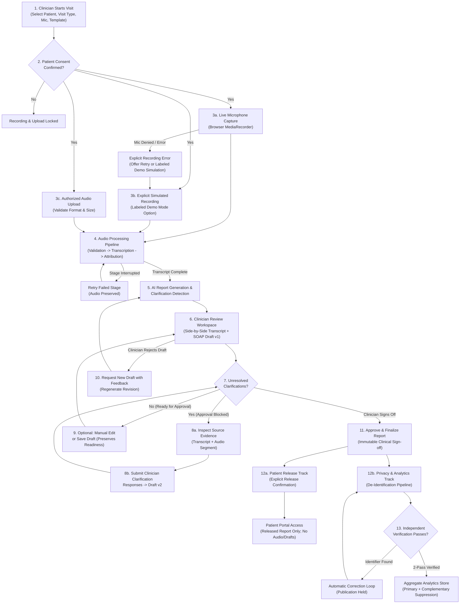
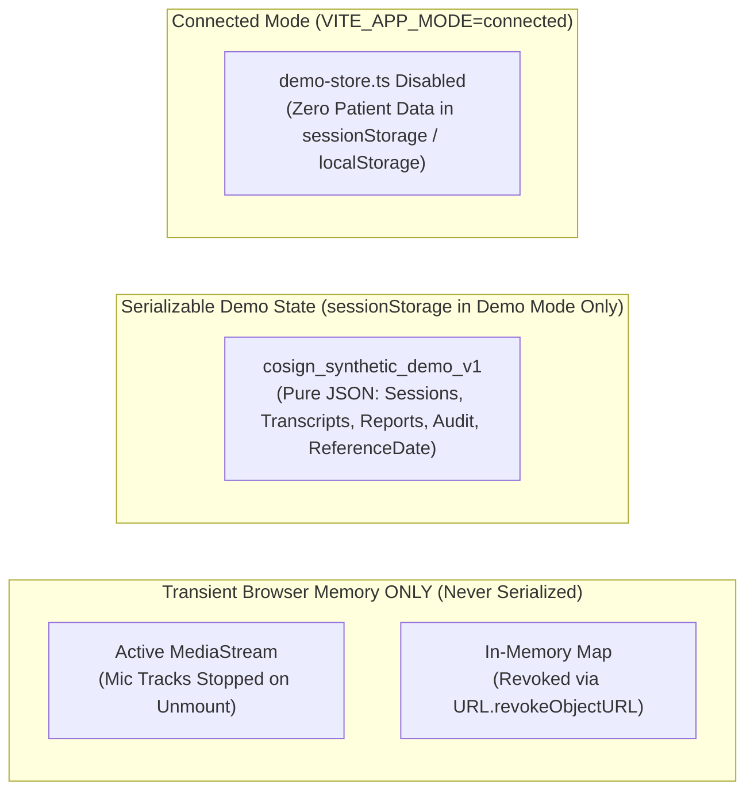

# CoSign — Sequence 1: System Architecture & Implementation Plan (Revised)

> [!IMPORTANT]
> **Sequence 1 (Architecture Revision — Planning Only):** No project files, dependencies, or configurations have been created in `/Users/sanjana/Capstone`. Complete Figma frame-by-frame analysis remains in [figma_inventory.md](file:///Users/sanjana/.gemini/antigravity/brain/ad650021-1d91-4c58-ad1a-68789bed5b15/figma_inventory.md).

---

## 1. Development Environment Verification & Runtime Baseline

| Check | Status | Verified Details & Action for Sequence 2 |
|---|---|---|
| Active Workspace | ✅ Verified | `/Users/sanjana/Capstone` (`0` files; isolated from any unrelated portfolio project) |
| Node.js Runtime Target | ⚠️ Upgrade in Seq 2 | Active shell defaulted to `~/.nvm/versions/node/v20.20.2` (Node 20 reached EOL in April 2026); `/usr/local/bin/node` has `v22.20.0`. **Target Runtime: Node.js 24 LTS (`>=24.0.0`)** via `.nvmrc` (`nvm install 24 && nvm use 24`). |
| Figma MCP Server | ✅ Verified | `figma-desktop` connected; all 62 frames, 9 symbols, and design variables cataloged in [figma_inventory.md](file:///Users/sanjana/.gemini/antigravity/brain/ad650021-1d91-4c58-ad1a-68789bed5b15/figma_inventory.md). |

---

## 2. Corrected Route & Component Inventory (62 Frames → 18 Routes + 13 Stateful Overlays)

### 2.1 Route Audit & Consolidation

In the initial draft, the heading misstated "19 routes" while the table listed 24 entries, and several session sub-pages and role duplicate routes caused unnecessary route proliferation. We have audited and consolidated the routing table to **18 distinct routes**:

1. **Consolidated Session Sub-Routes (`/clinician/sessions/:sessionId`):**
   Instead of separate routes for placeholder detail (`/:id`), processing (`/:id/processing`), and review (`/:id/review`), `/clinician/sessions/:sessionId` is now the **canonical Clinician Session Workspace** (`SessionWorkspacePage`) that renders the appropriate view based on the session's authoritative state (or `?tab=summary|privacy|history` / sub-routes where direct navigation is helpful). We retain explicit sub-routes for `/record`, `/summary`, `/privacy`, and `/history` because they represent distinct full-screen destinations in the Figma prototype (`13:91`, `14:915`, `15:418`, `15:588`).
2. **Consolidated Settings Route (`/settings`):**
   Rather than duplicating `/clinician/settings` (`17:413`) and `/admin/settings` (`17:468`), a single role-aware `/settings` route renders inside the active role's `AppShell`.
3. **Explicit Monthly & Cohort Analytics Views (`/clinician/analytics` & `/analyst/analytics`):**
   Both analytics routes explicitly support a segmented view switcher via URL query parameter `?view=cohort|monthly` (`cohort` = Verified Clinical Cohort Analytics from Figma Frames `47`–`50`; `monthly` = Monthly Documentation Operations & Cross-Month Attribution from §11), plus `/analyst/saved-views` for saved analyst presets.

### 2.2 Verified 18-Route Architecture Table

| # | Route Path | Role Scope | Page Component | Mapped Figma Frames (Node IDs) | State / URL Search Params |
|---|---|---|---|---|---|
| 1 | `/login` | Public / All | `RoleSelectionPage` | `01 [login]` (`12:2`) | Selects demo persona or authenticates in Connected Mode |
| 2 | `/clinician/dashboard` | `clinician` | `ClinicianDashboardPage` | `02 [dashboard]` (`12:60`) | Displays metrics for `DEMO_REFERENCE_DATE` (`2026-10-06`) + recent sessions |
| 3 | `/clinician/sessions` | `clinician` | `ClinicalSessionsPage` | `03 [sessions]` (`12:181`), `04 [filtered]` (`12:277`) | `?q=CS-1042&status=clarification_needed&date=2026-10-06` |
| 4 | `/clinician/sessions/new` | `clinician` | `StartVisitPage` | `05 [newvisit]` (`12:338`), `06 [consent]` (`12:401`) | Consent confirmation gate (`unconfirmed` → `confirmed`) |
| 5 | `/clinician/sessions/upload` | `clinician` | `UploadRecordingPage` | `13 [upload]` (`13:491`), `14 [uploadfailure]` (`13:545`) | Upload progress & retry state (`idle` \| `uploading` \| `failed`) |
| 6 | `/clinician/sessions/:sessionId/record` | `clinician` | `RecordVisitPage` | `09 [recording]` (`13:91`), `10 [paused]` (`13:222`), `11 [preview]` (`13:353`) | Capture mode (`live_mic` \| `simulated_demo`) & state (`recording` \| `paused` \| `preview`) |
| 7 | `/clinician/sessions/:sessionId` | `clinician` | `ClinicianSessionWorkspacePage` | `15` (`13:588`), `16` (`13:668`), `17` (`14:163`), `19` (`14:253`), `21` (`14:343`), `22` (`19:460`), `24` (`14:837`), `32` (`15:277`), `34` (`15:342`), `59`–`62` (`19:766`–`19:901`) | Renders Processing/Retry view (`15, 16, 24`) when job active/failed, or Clinician Review/Finalized workspace (`17, 19, 21, 22, 32, 34`) when transcript & report exist |
| 8 | `/clinician/sessions/:sessionId/summary` | `clinician` | `CollectedDataSummaryPage` | `25 [summary]` (`14:915`) | Structured SOAP + provenance links to transcript timestamps |
| 9 | `/clinician/sessions/:sessionId/privacy` | `clinician` | `PrivacyPipelinePage` | `35 [deid]` (`15:418`), `36 [verifyretry]` (`15:487`), `37 [verified]` (`15:531`) | De-identification & 2-pass verification pipeline view |
| 10 | `/clinician/sessions/:sessionId/history` | `clinician` | `ClinicalReportHistoryPage` | `38 [clinicalhistoryunreleased]` (`23:796`), `39 [clinicalhistory]` (`15:588`) | Revision & sign-off timeline for `:sessionId` |
| 11 | `/clinician/analytics` | `clinician` | `HealthcareAnalyticsPage` | `47 [analytics]` (`16:337`), `48 [analyticsfiltered]` (`16:436`) | `?view=cohort\|monthly&month=2026-09&diagnosis=diabetes&dept=all&status=verified_only` |
| 12 | `/patient` | `patient` | `PatientOverviewPage` | `40 [patient]` (`16:727`) | Patient welcome & latest released report banner |
| 13 | `/patient/reports` | `patient` | `PatientReportsListPage` | `41 [reports]` (`16:776`) | Lists only reports where `release.status === 'released'` |
| 14 | `/patient/reports/:reportId` | `patient` | `PatientReportDetailPage` | `42 [detail]` (`16:830`), `44 [pastreport]` (`16:945`), `45 [wellnessreport]` (`19:946`) | Renders released report + Next Steps card |
| 15 | `/patient/history` | `patient` | `PatientReportHistoryPage` | `43 [history]` (`16:890`) | Chronological patient care timeline |
| 16 | `/analyst/analytics` | `analyst` | `HealthcareAnalyticsPage` | `49 [analyst]` (`16:529`), `50 [analystfiltered]` (`16:624`), `Saved views` nav | `?view=cohort\|monthly&preset=...` (Verified aggregate + saved filter presets) |
| 17 | `/admin` | `admin` | `AdminWorkspacePage` | `52 [admin]` (`17:533`), `53 [users]` (`17:592`), `55 [audit]` (`17:659`) | `?tab=overview\|users\|audit` (Overview cards, Users & Access table, Append-only Audit Log) |
| 18 | `/settings` | `clinician`, `admin` | `WorkspaceSettingsPage` | `56 [settings]` (`17:413`), `57 [adminsettings]` (`17:468`) | Role-aware workspace preferences |

### 2.3 Verified 13 Stateful Modals, Drawers & Overlays

| # | Overlay Component | Host Page | Mapped Figma Frames (Node IDs) |
|---|---|---|---|
| 1 | `MicrophoneSelectDialog` | `StartVisitPage` | `07 [microphone]` (`12:530`) |
| 2 | `ReportTemplateDialog` | `StartVisitPage` | `08 [template]` (`12:544`) |
| 3 | `DiscardRecordingDialog` | `RecordVisitPage` | `12 [discard]` (`13:481`) |
| 4 | `ResolveClarificationsDialog` | `ClinicianSessionWorkspacePage`, `EvidenceInspectorDrawer` | `18 [clarify]` (`14:785`) |
| 5 | `EditReportDialog` | `ClinicianSessionWorkspacePage` | `20 [edit]` (`14:805`) |
| 6 | `RejectDraftDialog` | `ClinicianSessionWorkspacePage` | `23 [reject]` (`14:823`) |
| 7 | `EvidenceInspectorDrawer` | `ClinicianSessionWorkspacePage`, `CollectedDataSummaryPage` | `26 [source]` (`14:523`), `27 [sourceplaying]` (`14:654`), `28 [sourcesymptoms]` (`19:516`), `29 [sourceglucose]` (`19:641`), `30 [sourceallergy]` (`14:433`) |
| 8 | `ApproveReportDialog` | `ClinicianSessionWorkspacePage` | `31 [confirm]` (`14:978`) |
| 9 | `ReleaseToPatientDialog` | `ClinicianSessionWorkspacePage` | `33 [release]` (`15:407`) |
| 10 | `PrintableReportDialog` | `PatientReportDetailPage` | `46 [print]` (`16:987`) |
| 11 | `ExportAggregateDialog` | `HealthcareAnalyticsPage` | `51 [export]` (`16:713`) |
| 12 | `RolePermissionsDialog` | `AdminWorkspacePage` (`?tab=users`) | `54 [permissions]` (`17:648`) |
| 13 | `PreferencesSavedDialog` | `WorkspaceSettingsPage` | `58 [preferencessaved]` (`17:523`) |

**Accounting Totals:** All **62 Figma frames** are accounted for across **18 routes** and **13 modal/drawer overlays**.

---

## 3. Clinical Workflow & Actual Figma UI Observations

### 3.1 End-to-End Clinical Workflow Diagram



---

## 4. Parkview Health Benchmark & Proposed Design System

*(Preserved from initial review; all contrast ratios verified against WCAG 2.2 AA `>= 4.5:1` text and `>= 3.0:1` UI boundaries.)*

| Token Name | CSS Variable | Hex Value | Usage & Contrast Verification |
|---|---|---|---|
| **Primary 900 (Sidebar Bg)** | `--color-nav-bg` | `#0f3b2b` | Deep Parkview forest green sidebar (`10.72:1` with `#e3f1e9`) |
| **Primary 700 (Brand Primary)** | `--color-primary` | `#1a6b4a` | Primary buttons, active nav pill (`6.47:1` with `#ffffff`) |
| **Primary 800 (Primary Hover)** | `--color-primary-hover` | `#145539` | Hover/active state for primary buttons (`8.79:1` with `#ffffff`) |
| **Primary 50 (Brand Soft)** | `--color-primary-soft` | `#eef6f1` | Soft green tint for active chips, info callouts (`5.88:1` with `#1a6b4a`) |
| **Secondary 700 (CoSign Teal)** | `--color-secondary` | `#146b70` | Preserved CoSign teal for timestamps, AI provenance, charts (`6.24:1` with `#ffffff`) |
| **Secondary 50 (Teal Soft)** | `--color-secondary-soft` | `#e6f3f1` | Timestamp chip background (`5.48:1` with `#146b70`) |
| **Canvas / Surface / Muted** | `--color-canvas` / `-surface` | `#f5f8f6` / `#ffffff` | Sage-tinted off-white canvas and crisp white cards |
| **Ink Primary / Muted** | `--color-ink` / `-ink-muted` | `#14292e` / `#4d6168` | Body text (`15.15:1`) and secondary labels (`6.51:1`) |
| **Border Subtle / Strong** | `--color-border` / `-strong` | `#d5e0dd` / `#6f8287` | Card dividers and `4.02:1` accessible form control borders |
| **Semantic Status Pairs** | `--color-success` / `warning` / `danger` / `info` | `#276749` / `#8c530a` / `#b42318` / `#1d5b85` | Paired with soft tints (`#e8f4ed`, `#fff3dc`, `#fdecea`, `#e8f1f8`) and icons |

---

## 5. Modernized Technology Stack (Verified October 2026 Registry Versions)

We queried the live npm registry (`npm view <pkg> dist-tags engines peerDependencies`) to verify current October 2026 stable versions and cross-package compatibility.

### 5.1 Runtime Baseline: Node.js 24 LTS
- **Selected Runtime:** **Node.js 24 LTS (`^24.x`, Active LTS)** configured via `.nvmrc` (`24`) and `package.json` `"engines": { "node": "^22.22.0 || >=24.0.0" }`.
- **Why Node 20 is Replaced:** Node 20 reached End-of-Life in April 2026. Furthermore, current stable `vitest@5.0.5` requires `node: "^22.12.0 || ^24.0.0 || >=26.0.0"` and `react-router@8.5.0` requires `node: ">=22.22.0"`. Upgrading the workspace to Node 24 LTS unlocks the current 2026 toolchain without engine errors.

### 5.2 Verified Dependency Table

| Package | Registry `latest` (Oct 2026) | Recommended Version | Phase Needed | Verified Compatibility & Selection Rationale |
|---|---|---|---|---|
| **Node.js** | `24.x LTS` | **`24.x LTS`** (`.nvmrc`) | Sequence 2 | Active LTS; satisfies `vitest@5`, `vite@8`, `react-router@8`, and `eslint@10`. |
| **React + React DOM** | `19.3.1` | **`^19.3.1`** | Sequence 2 | Current stable React 19 release. Supported by Radix UI `1.8.1`, TanStack Query `5.104.5`, Recharts `3.10.1`, and RTL `16.3.3`. |
| **TypeScript** | `7.0.2` (`6.0.3` in 6.x) | **`~6.0.3`** *(see note below)* | Sequence 2 | **Compatibility finding:** While `typescript@7.0.2` is `latest`, `typescript-eslint@8.72.0` declares `peerDependencies: { "typescript": ">=4.8.4 <6.1.0" }`. Pinning **`~6.0.3`** uses the newest TypeScript release that satisfies `typescript-eslint` without peer-dependency breakage. |
| **Vite** | `8.3.4` | **`^8.3.4`** (`@vitejs/plugin-react@^6.1.2`) | Sequence 2 | Current stable Vite 8 (Oxc/Rolldown powered) with sub-second dev startup and clean static production builds. |
| **React Router** | `8.5.0` (`7.18.4` in v7) | **`^7.18.4`** | Sequence 2 | Selected **v7.18.4** over newly released `8.5.0` for proven ecosystem stability. Supports `react: ">=18"` (including `19.3.1`) and Node `>=20.0.0` (including Node 22.20 / 24 LTS). |
| **Tailwind CSS** | `4.3.3` | **`^4.3.3`** + `@tailwindcss/vite@^4.3.3` | Sequence 2 | Current stable Tailwind v4. Uses native `@tailwindcss/vite` plugin (supports `vite@^8`) and CSS-first `@theme` blocks that map directly to our Parkview/CoSign CSS custom properties. |
| **Radix UI (shadcn pattern)** | `1.8.1` | **`radix-ui@^1.8.1`** | Sequence 2 | Modern unified `radix-ui` package supporting React 19 (`Dialog`, `Select`, `Tabs`, `Tooltip`). |
| **Lucide React** | `1.60.0` | **`^1.60.0`** | Sequence 2 | Current stable v1 icon library for accessible status indicators and clinical actions. |
| **TanStack Query** | `5.104.5` | **`^5.104.5`** | Sequence 2 | Current stable v5; full React 19 support for async service state, polling (`refetchInterval`), and cache invalidation. |
| **Zod** | `4.6.7` | **`^4.6.7`** | Sequence 2 | Current stable Zod v4; faster schema parsing and TypeScript inference for forms and API responses. |
| **Vitest + RTL + JSDOM** | `5.0.5` / `16.3.3` / `29.0.0` | **`vitest@^5.0.5`**, **`@testing-library/react@^16.3.3`**, **`jsdom@^29.0.0`** | Sequence 2 | `vitest@5.0.5` and `jsdom@29.0.0` pair natively with `vite@^8.3.4` on Node 22.13+ / 24 LTS without peer conflicts. |
| **Playwright** | `1.64.1` | **`@playwright/test@^1.64.1`** | Sequence 3/4 | Current stable browser automation suite. |
| **Recharts** | `3.10.1` | **`^3.10.1`** | Sequence 4 | Current stable Recharts v3 with native React 19 peer support (`react: "^19.0.0"`). Deferred until Sequence 4 when Analytics is built. |
| **ESLint + Prettier** | `10.13.0` (`9.39.5` v9) / `3.9.10` | **`eslint@^9.39.5`**, **`typescript-eslint@^8.72.0`**, **`eslint-plugin-jsx-a11y@^6.10.2`**, **`prettier@^3.9.10`** | Sequence 2 | **Compatibility finding:** `eslint-plugin-jsx-a11y@6.10.2` declares `peerDependencies.eslint: "^3..\|^9"`. Selecting `eslint@^9.39.5` with `@eslint/js@^9.39.5` avoids peer conflicts while keeping flat config (`eslint.config.js`) and full accessibility linting. |

---

## 6. Modular Frontend Architecture

*(Folder structure preserved; feature components are built incrementally in Sequences 3 and 4 rather than all at once in Sequence 2.)*

```text
/Users/sanjana/Capstone/
├── .nvmrc                               # Pin Node 24 LTS ("24")
├── src/
│   ├── app/                             # Bootstrap, AppProviders, RoleGuard, 18-route table
│   ├── config/                          # env.ts (VITE_APP_MODE, VITE_API_BASE_URL, VITE_DEMO_REFERENCE_DATE)
│   ├── design-system/                   # Parkview tokens.css + core reusable UI primitives + AppShell
│   ├── domain/                          # Orthogonal domain models, derived status selectors, state guards
│   ├── services/                        # contracts/ (ICoSignServices), demo/ (serializable store + transient media registry), api/
│   ├── features/                        # Built per sequence:
│   │   ├── auth/                        # Sequence 2: RoleSelectionPage
│   │   ├── clinician-dashboard/         # Sequence 3: ClinicianDashboardPage
│   │   ├── clinical-sessions/           # Sequence 3: ClinicalSessionsPage
│   │   ├── clinician-review/            # Sequence 3: ClinicianSessionWorkspacePage, modals, drawer, summary
│   │   ├── approval-release/            # Sequence 3: Approval, release, privacy pipeline, report history
│   │   ├── visit-capture/               # Sequence 4: StartVisit, RecordVisit, Upload, audio-recorder
│   │   ├── analytics/                   # Sequence 4: HealthcareAnalyticsPage & suppression engine
│   │   ├── patient-portal/              # Sequence 4: PatientOverview, Reports, Detail, History
│   │   ├── administration/              # Sequence 4: AdminWorkspacePage (Overview, Users, Audit)
│   │   └── settings/                    # Sequence 4: WorkspaceSettingsPage
│   └── test/                            # Vitest setup & test helpers
```

---

## 7. Normalized Domain State Management (Orthogonal Lifecycles)

### 7.1 Eliminating Overlapping Status Fields

In the initial draft, `ClinicalSession.status` (`SessionLifecycleStatus`) duplicated values already represented by `ReportApprovalStatus`, `PatientReleaseState`, and `DeIdentificationState` (such as `'needs_clarification'`, `'approved_finalized'`, and `'released'`), creating multiple mutable fields that could drift out of sync.

**Revised Rule — Five Orthogonal Authoritative Lifecycles:**
Each clinical session owns five strictly separate, non-overlapping state sub-objects. **No status value is stored in two places.**

1. **`captureState` (`CaptureLifecycleState`):** Authoritative state for consent, microphone recording, or file upload.
2. **`processingState` (`ProcessingLifecycleState`):** Authoritative state for the async transcription/AI drafting pipeline (`AudioProcessingJob`).
3. **`reviewState` (`ReportReviewLifecycleState`):** Authoritative state for the clinical report's draft readiness, persistence (`isDraftSaved`), clarification count, and clinician approval/finalization.
4. **`releaseState` (`PatientReleaseState`):** Authoritative state for whether the finalized report has been shared with the patient.
5. **`privacyState` (`PrivacyVerificationState`):** Authoritative state for de-identification, 2-pass verification, and analytics eligibility.

### 7.2 Preserving Draft Readiness When Saving (`isDraftSaved` Orthogonal Flag)

Saving a draft (`14:343` or `19:460`) **never overwrites** whether the report is blocked by clarifications or ready for approval. Instead, `reviewState` models:
- `status: 'not_started' | 'draft_requires_clarification' | 'draft_ready_for_approval' | 'regenerating' | 'approved_finalized'`
- `isDraftSaved: boolean` + `lastSavedRevision?: number` + `lastSavedAt?: string`

Thus:
- **Figma Frame 17 (`14:163` `[review]`):** `status: 'draft_requires_clarification'`, `isDraftSaved: false`
- **Figma Frame 21 (`14:343` `[saved]`):** `status: 'draft_requires_clarification'`, `isDraftSaved: true` *(still blocked from approval!)*
- **Figma Frame 19 (`14:253` `[reviewready]`):** `status: 'draft_ready_for_approval'`, `isDraftSaved: false`
- **Figma Frame 22 (`19:460` `[savedready]`):** `status: 'draft_ready_for_approval'`, `isDraftSaved: true` *(ready for approval!)*
- **Figma Frame 32 (`15:277` `[finalized]`):** `status: 'approved_finalized'`, `releaseState.status: 'not_released'`
- **Figma Frame 34 (`15:342` `[released]`):** `status: 'approved_finalized'`, `releaseState.status: 'released'`

### 7.3 Revised TypeScript Domain Models (`src/domain/models/`)

```typescript
// 1. Authoritative Lifecycle 1: Capture & Consent
export type CaptureStatus =
  | 'consent_pending'
  | 'ready_to_capture'
  | 'recording_active'
  | 'recording_paused'
  | 'recording_error'
  | 'recording_ready'
  | 'uploading'
  | 'upload_failed'
  | 'capture_completed';

export type CaptureOrigin = 'unselected' | 'live_microphone' | 'simulated_demo_audio' | 'uploaded_file';

export interface CaptureLifecycleState {
  readonly status: CaptureStatus;
  readonly origin: CaptureOrigin;
  readonly consentConfirmed: boolean;
  readonly consentConfirmedAt?: string;
  readonly consentConfirmedByUserId?: string;
  readonly recordingId?: string;
  readonly uploadProgressPct?: number; // e.g., 62 on upload failure (Frame 13:545)
  readonly errorCode?: 'MIC_PERMISSION_DENIED' | 'MIC_DEVICE_UNAVAILABLE' | 'UPLOAD_INTERRUPTED' | 'UNSUPPORTED_AUDIO_FORMAT';
  readonly errorMessage?: string;
}

// 2. Authoritative Lifecycle 2: Audio & AI Processing Pipeline
export type ProcessingStatus =
  | 'idle'
  | 'running'
  | 'failed_retryable'
  | 'completed';

export interface ProcessingLifecycleState {
  readonly status: ProcessingStatus;
  readonly activeJobId?: string;
  readonly kind?: 'initial_processing' | 'draft_regeneration';
  readonly stages: readonly PipelineStageState[];
  readonly failedStage?: PipelineStageKey;
  readonly retryCount: number;
  readonly maxRetries: number;
}

// 3. Authoritative Lifecycle 3: Report Review & Approval
export type ReviewApprovalStatus =
  | 'not_generated'
  | 'draft_requires_clarification'
  | 'draft_ready_for_approval'
  | 'approved_finalized';

export interface ReportReviewLifecycleState {
  readonly status: ReviewApprovalStatus;
  readonly currentReportId?: string;
  readonly currentRevision: number;          // 0 before generation, 1 for v1, 2 for v2
  readonly unresolvedClarificationCount: number;
  readonly isDraftSaved: boolean;            // Orthogonal to status!
  readonly lastSavedRevision?: number;
  readonly lastSavedAt?: string;
  readonly reviewStartedAt?: string;         // Set when clinician first opens draft or draft completes
  readonly approvedAt?: string;
  readonly approvedRevision?: number;
  readonly approvedByUserId?: string;
  readonly approvedByDisplayName?: string;
}

// 4. Authoritative Lifecycle 4: Patient Portal Release
export type ReleaseStatus = 'not_released' | 'released';

export interface PatientReleaseState {
  readonly status: ReleaseStatus;
  readonly releasedRevision?: number;
  readonly releasedAt?: string;
  readonly releasedByUserId?: string;
  readonly releasedByDisplayName?: string;
}

// 5. Authoritative Lifecycle 5: Privacy & Analytics Verification
export type PrivacyStatus =
  | 'not_started'
  | 'deidentifying'
  | 'verification_retry_required'
  | 'verified_eligible';

export interface PrivacyVerificationState {
  readonly status: PrivacyStatus;
  readonly safeHarborChecked: boolean;
  readonly independentPassesCompleted: number; // Target: 2
  readonly lastProcessedAt?: string;
  readonly retryReason?: string;
}

// Aggregate ClinicalSession Entity (Single Source of Truth per Lifecycle)
export interface ClinicalSession {
  readonly id: string;                       // "CS-1042"
  readonly patientId: string;                // "pat-alex-morgan"
  readonly patientName: string;              // "Alex Morgan"
  readonly assignedClinicianId: string;      // "usr-clinician-lee"
  readonly assignedClinicianName: string;    // "Dr. Jordan Lee"
  readonly department: DepartmentId;
  readonly visitType: string;                // "Diabetes follow-up"
  readonly diagnosisCategory: 'diabetes' | 'hypertension' | 'URI_acute' | 'wellness' | 'other';
  readonly templateId: ReportTemplateId;
  readonly encounterDate: string;            // "2026-10-06" (YYYY-MM-DD in clinic timezone)
  readonly createdAt: string;                // ISO-8601
  readonly updatedAt: string;
  readonly capture: CaptureLifecycleState;
  readonly processing: ProcessingLifecycleState;
  readonly review: ReportReviewLifecycleState;
  readonly release: PatientReleaseState;
  readonly privacy: PrivacyVerificationState;
}
```

### 7.4 Pure Derived Selector for Dashboard & Table Display (`deriveSessionDisplayState`)

Dashboard counters, table status badges, and "Next Step" CTA buttons are **purely derived** from the five orthogonal lifecycles (`src/domain/state-machines/derive-display-state.ts`):

```typescript
export type DerivedSessionDisplayCode =
  | 'CONSENT_NEEDED'
  | 'RECORDING_IN_PROGRESS'
  | 'UPLOAD_INTERRUPTED'
  | 'PROCESSING'
  | 'PROCESSING_INTERRUPTED'
  | 'CLARIFICATION_NEEDED'
  | 'NEEDS_REVIEW'
  | 'DRAFT_SAVED_NEEDS_CLARIFICATION'
  | 'DRAFT_SAVED_READY'
  | 'APPROVED_NOT_RELEASED'
  | 'RELEASED';

export function deriveSessionDisplayState(s: ClinicalSession): {
  code: DerivedSessionDisplayCode;
  badgeLabel: string;
  badgeTone: 'neutral' | 'info' | 'warning' | 'danger' | 'success';
  nextStepLabel: string;
} {
  if (s.release.status === 'released') {
    return { code: 'RELEASED', badgeLabel: 'Released', badgeTone: 'success', nextStepLabel: 'View report' };
  }
  if (s.review.status === 'approved_finalized') {
    return { code: 'APPROVED_NOT_RELEASED', badgeLabel: 'Approved · Not released', badgeTone: 'success', nextStepLabel: 'Release to patient' };
  }
  if (s.processing.status === 'failed_retryable') {
    return { code: 'PROCESSING_INTERRUPTED', badgeLabel: 'Processing interrupted', badgeTone: 'danger', nextStepLabel: 'Retry processing' };
  }
  if (s.processing.status === 'running') {
    return { code: 'PROCESSING', badgeLabel: 'Processing', badgeTone: 'info', nextStepLabel: 'View progress' };
  }
  if (s.capture.status === 'upload_failed') {
    return { code: 'UPLOAD_INTERRUPTED', badgeLabel: 'Upload interrupted', badgeTone: 'danger', nextStepLabel: 'Retry upload' };
  }
  if (s.review.status === 'draft_requires_clarification') {
    return {
      code: s.review.isDraftSaved ? 'DRAFT_SAVED_NEEDS_CLARIFICATION' : 'CLARIFICATION_NEEDED',
      badgeLabel: 'Clarification needed',
      badgeTone: 'warning',
      nextStepLabel: 'Review visit',
    };
  }
  if (s.review.status === 'draft_ready_for_approval') {
    return {
      code: s.review.isDraftSaved ? 'DRAFT_SAVED_READY' : 'NEEDS_REVIEW',
      badgeLabel: s.review.isDraftSaved ? 'Saved · Ready for review' : 'Needs review',
      badgeTone: 'info',
      nextStepLabel: 'Review visit',
    };
  }
  return { code: 'CONSENT_NEEDED', badgeLabel: 'Setup visit', badgeTone: 'neutral', nextStepLabel: 'Continue setup' };
}
```

### 7.5 Complete Rejection, Regeneration, Revision & Stale-Approval Prevention Rules

To guarantee that prior revisions are never lost, rejection/regeneration transitions are unambiguous, and stale approvals are impossible:
1. **Immutable Revision History (`report.revisions`):**
   - Every report starts at `currentRevision: 1` (`revisions: [v1]`).
   - Resolving clarifications (`applyClarificationResponses`), saving clinician edits (`saveEditedReport`), or completing an AI draft regeneration (`completeDraftRegeneration`) appends a **new immutable `ReportRevision` (`revisionNumber = currentRevision + 1`)** to `report.revisions` while preserving all prior revisions (`v1`, `v2`, ...) for inspection in `ClinicalReportHistoryPage`.
2. **Rejection & Regeneration Lifecycle Coordination:**
   - When a clinician rejects a draft (`rejectAndRegenerateDraft(baseRevision, feedbackReason)`):
     - Requires `baseRevision === session.review.currentRevision` and `session.review.status !== 'approved_finalized'`.
     - Records the rejection reason and timestamp on the rejected revision entry (`rejectedAt`, `rejectionReason`).
     - Sets `session.processing` to `{ status: 'running', kind: 'draft_regeneration' }` and resets `session.review.isDraftSaved = false`.
     - While `session.processing.status === 'running'`, all review mutations (clarify, edit, save, approve, reject) are locked.
     - When regeneration completes, a new revision (`currentRevision + 1`) is appended and `session.review.status` transitions to `'draft_requires_clarification'` (if the regenerated draft flags questions) or `'draft_ready_for_approval'` (if 0 unresolved questions).
3. **Stale-Approval & Optimistic Concurrency Prevention:**
   - Every mutation (`resolveClarifications`, `saveDraft`, `editReport`, `rejectDraft`, `approveAndFinalize`, `releaseToPatient`) requires an explicit `expectedRevision: number` parameter.
   - If `expectedRevision !== session.review.currentRevision`, the transition throws a typed `REVISION_CONFLICT` error (`Stale revision: expected vX, but current report is vY`), preventing a clinician or background task from approving or releasing an outdated draft.

### 7.6 Hardened Guard Functions (Ownership + Lifecycle Invariants)

Every guard verifies **actor role, session ownership (`assignedClinicianId === user.id`), and lifecycle state** (while documenting that Connected Mode backend endpoints enforce these checks independently on the server):

```typescript
export function isAssignedClinician(user: User, session: ClinicalSession): boolean {
  return user.role === 'clinician' && session.assignedClinicianId === user.id;
}

export function canStartOrUploadCapture(user: User, session: ClinicalSession): boolean {
  return (
    isAssignedClinician(user, session) &&
    session.capture.consentConfirmed &&
    (session.capture.status === 'ready_to_capture' ||
     session.capture.status === 'recording_error' ||
     session.capture.status === 'upload_failed')
  );
}

export function canResolveClarifications(user: User, session: ClinicalSession, report: ClinicalReport): boolean {
  return (
    isAssignedClinician(user, session) &&
    session.processing.status !== 'running' &&
    session.review.status === 'draft_requires_clarification' &&
    report.clarifications.some(c => c.status === 'unresolved')
  );
}

export function canSaveOrEditDraft(user: User, session: ClinicalSession): boolean {
  return (
    isAssignedClinician(user, session) &&
    session.processing.status !== 'running' &&
    (session.review.status === 'draft_requires_clarification' ||
     session.review.status === 'draft_ready_for_approval')
  );
}

export function canApproveAndFinalize(user: User, session: ClinicalSession, report: ClinicalReport): boolean {
  return (
    isAssignedClinician(user, session) &&
    session.processing.status === 'completed' &&
    session.review.status === 'draft_ready_for_approval' &&
    session.review.unresolvedClarificationCount === 0 &&
    report.clarifications.every(c => c.status === 'resolved') &&
    report.currentRevision === session.review.currentRevision
  );
}

export function canReleaseReportToPatient(user: User, session: ClinicalSession): boolean {
  return (
    isAssignedClinician(user, session) &&
    session.review.status === 'approved_finalized' &&
    session.release.status === 'not_released'
  );
}
```

---

## 8. Audio Recording Architecture & Runtime Format Negotiation

### 8.1 Honest Microphone Capture vs. Explicitly Labeled Simulated Recording

**We never silently substitute simulated audio when real microphone capture fails.**
1. **Two Distinct User Paths on `StartVisitPage` / `RecordVisitPage`:**
   - **Primary Action — `"Start Microphone Recording"` (`origin: 'live_microphone'`):** Requests `navigator.mediaDevices.getUserMedia({ audio: true })`.
   - **Secondary Demo Option — `"Run Simulated Demo Recording"` (`origin: 'simulated_demo_audio'`):** Clearly labeled button for presentations where the presenter does not wish to speak an 8-minute clinical encounter live. Displays a prominent badge: `Simulated Demo Audio · No Microphone Used`.
2. **Explicit Error Handling When Microphone Permission is Denied or Unavailable:**
   - If `getUserMedia` rejects with `NotAllowedError`, `NotFoundError`, or `NotReadableError` (or `window.isSecureContext === false`), the session transitions to `capture.status = 'recording_error'` with `errorCode: 'MIC_PERMISSION_DENIED' | 'MIC_DEVICE_UNAVAILABLE'`.
   - The UI displays an explicit error banner explaining why microphone capture failed, never claims audio was recorded, and offers two clear recovery buttons:
     1. `"Retry Microphone Access"`
     2. `"Switch to Labeled Simulated Demo Recording"`

### 8.2 Runtime MIME Type Detection & Format Negotiation Strategy

Standard browser `MediaRecorder` implementations do **not** reliably produce `audio/wav` across engines (Chromium/Firefox prefer `audio/webm;codecs=opus`; Safari/WebKit prefers `audio/mp4`).
- **Runtime Probing (`negotiateSupportedAudioMimeType()`):**
  ```typescript
  const CANDIDATE_MIME_TYPES = [
    'audio/webm;codecs=opus',
    'audio/webm',
    'audio/mp4;codecs=mp4a.40.2',
    'audio/mp4',
    'audio/wav',
  ] as const;

  export function detectSupportedRecordingMimeType(): string | null {
    if (typeof window === 'undefined' || typeof MediaRecorder === 'undefined') return null;
    for (const mime of CANDIDATE_MIME_TYPES) {
      if (MediaRecorder.isTypeSupported(mime)) return mime;
    }
    return ''; // Let browser choose default container or fail explicitly
  }
  ```
- **Upload Validation vs. Live Recording Negotiation:**
  - **File Uploads (`13:491`):** Accept `.wav`, `.webm`, `.mp4`, `.m4a`, `.mp3` up to configurable max size (e.g., `50 MB`).
  - **Future Backend Format Negotiation (`Connected Mode`):**
    1. The recording metadata payload sends the exact captured `mimeType` (`audio/webm;codecs=opus`, `audio/mp4`, or `audio/wav`) and sample rate to `POST /api/v1/sessions/:id/audio`.
    2. Virtually all modern transcription backends (faster-whisper / Whisper.cpp / ffmpeg-backed Python services) decode `webm`, `mp4`, and `wav` natively via `ffmpeg` / `av`.
    3. If a teammate's service strictly requires `16kHz mono PCM WAV`, our `audio-recorder.ts` module provides an optional client-side `AudioContext.decodeAudioData` → `OfflineAudioContext(1, length, 16000)` PCM WAV encoder utility so no UI code changes are ever required.

---

## 9. Hardened Demo Persistence & Transient Resource Separation

### 9.1 Strict Separation Between Serializable Demo State & Transient Browser Memory



1. **What May Be Serialized to `sessionStorage` (Demo Mode Only):**
   - Pure JSON synthetic domain entities (`ClinicalSession`, `RecordingMetadata` *without* URLs/blobs, `Transcript`, `ClinicalReport`, `AuditEvent`, and active `demoReferenceDate`).
   - Validated by a strict serializer guard that strips any field matching `blob:`, `MediaStream`, `Blob`, or `ArrayBuffer`.
2. **What stays strictly in `TransientMediaRegistry` (In-Memory `Map`):**
   - Active `MediaStream` instances (tracks are deterministically stopped via `stream.getTracks().forEach(t => t.stop())` on stop, discard, or component unmount).
   - Recorded `Blob` objects and `URL.createObjectURL(blob)` references.
3. **Behavior Across Page Refresh & Reset:**
   - **After Page Refresh (F5) in Demo Mode:** All workflow state transitions (e.g., resolved clarifications, saved Draft v2, approved/released status, audit events, and `RecordingMetadata`) survive cleanly from `sessionStorage`. If the user recorded live microphone audio before refreshing, `RecordingMetadata` (`durationSeconds`, `mimeType`, `origin: 'live_microphone'`) remains intact while the transient in-memory `Blob` is marked evicted; audio playback in the Evidence Drawer uses the deterministic synthetic segment player.
   - **On `"Reset Demo State"`:**
     1. Stops any active `MediaStream` tracks.
     2. Calls `URL.revokeObjectURL()` on all entries in `TransientMediaRegistry` and clears the `Map`.
     3. Removes `sessionStorage.removeItem('cosign_synthetic_demo_v1')`.
     4. Re-initializes the in-memory store from deep-cloned canonical fixtures (`src/services/demo/fixtures/*`).
     5. Calls `queryClient.clear()` / `queryClient.invalidateQueries()` and resets the view.
4. **Connected Mode Isolation Guarantee:**
   - When `VITE_APP_MODE === 'connected'`, `ServiceProvider` mounts `createConnectedServices()` and **never instantiates `demo-store.ts`**. Connected Mode writes **zero** clinical sessions, reports, or patient records to `sessionStorage` or `localStorage`.

---

## 10. Explicit Demo Reference Date & Timezone Rules

### 10.1 Configurable `DEMO_REFERENCE_DATE` (`2026-10-06`)

Rather than calling `new Date()` and pretending the real wall-clock date is October 6, 2026 (or showing misleading "Today" counters that break on other dates), CoSign defines an explicit **Clinic Reference Clock** (`src/config/clock.ts`):
- **Default Demo Reference Date:** `2026-10-06` (`Oct 6, 2026`, matching every Figma frame's top bar).
- **Default Clinic Timezone:** `America/Indiana/Indianapolis` (Eastern Time, aligning with Parkview Health's Indiana benchmark and deterministic calendar-day boundaries).
- **Top Bar & Dashboard Labeling:**
  - Top bar displays: `Oct 6, 2026 (Demo Reference Date)` in Demo Mode, or the live clinic date in Connected Mode.
  - Dashboard KPI `"Today's sessions (Oct 6)"` filters strictly by `session.encounterDate === clock.getReferenceDateString()` (`"2026-10-06"`).
  - Dashboard KPI `"Released today (Oct 6)"` filters strictly by sessions whose `release.releasedAt` falls on `2026-10-06` in the clinic timezone.

### 10.2 Canonical Fixture Alignment on `2026-10-06`

To ensure the Figma Dashboard KPIs (`Today's sessions: 8`, `Needs review: 2`, `Clarification needed: 1`, `Released today: 3`) are 100% mathematically derived from actual records in the store on `2026-10-06`:
- **5 Featured Table Sessions on `2026-10-06`:**
  1. `CS-1048` (`Acute visit`, `06:24`) → `processing.status: 'running'`
  2. `CS-1047` (`Hypertension follow-up`, `10:16`) → `review.status: 'draft_ready_for_approval'` (**Needs review #1**)
  3. `CS-1042` (`Diabetes follow-up`, `08:42`, Alex Morgan) → `review.status: 'draft_requires_clarification'` (`2 questions`) (**Clarification needed #1**)
  4. `CS-1045` (`Primary care visit`, `07:10`) → `processing.status: 'failed_retryable'`
  5. `CS-1043` (`Wellness consultation`, `12:05`) → `release.status: 'released'` on `2026-10-06` (**Released today #1**)
- **3 Completed Morning Sessions on `2026-10-06` (Visible in `"View all sessions"`):**
  6. `CS-1046` (`Lipid panel follow-up`, `09:15`) → `review.status: 'draft_ready_for_approval'` (**Needs review #2**)
  7. `CS-1044` (`Annual physical`, `11:20`) → `release.status: 'released'` on `2026-10-06` (**Released today #2**)
  8. `CS-1041` (`Asthma check`, `07:45`) → `release.status: 'released'` on `2026-10-06` (**Released today #3**)
- **Historical Released Reports for Patient Alex Morgan (Separate Encounter Dates):**
  - `CS-0988` (`Routine follow-up`, `encounterDate: "2026-09-18"`) — Frame `16:945`
  - `CS-0840` (`Wellness consultation`, `encounterDate: "2026-08-02"`) — Frame `19:946` *(kept distinct from `CS-1043` so Alex Morgan's Aug 2 wellness report and Oct 6 `CS-1043` never conflict!)*

---

## 11. Strengthened Analytics Privacy, Suppression & Monthly Rules

### 11.1 Accurate Privacy Terminology (Minimum Cell-Size Suppression vs. Full De-Identification)

We **do not** claim that suppressing cells with `count < 5` by itself achieves formal mathematical $k$-anonymity or complete HIPAA Safe Harbor / Expert Determination de-identification. Instead, CoSign models two distinct layers:
1. **Upstream Record De-Identification & 2-Pass Verification (`PrivacyVerificationState`):** Removes direct patient identifiers from approved reports before any analytics record is emitted (`15:418`–`15:531`).
2. **Downstream Aggregate Disclosure Control (`Minimum Cell-Size Threshold n >= 5` + Complementary Suppression):** Protects aggregate visualizations and exports from small-group disclosure.

### 11.2 Primary, Complementary & Cross-Filter Suppression Rules

To prevent an analyst or clinician from deducing a suppressed cell (`1 <= count <= 4`) via subtraction from totals, percentages, or complementary categories, `aggregation-engine.ts` enforces four deterministic rules:

1. **Rule 1 — Primary Cell Suppression (`0 < count < 5`):**
   Any category with `1..4` records is masked (`count: null`, `percentage: null`, `display: "Suppressed (<5)"`). Zero counts (`0`) are either omitted or explicitly policy-masked if paired with a suppressed sibling.
2. **Rule 2 — Complementary (Secondary) Suppression:**
   In any mutually exclusive breakdown that sums to a known cohort total $N$ (such as `Primary symptoms` or `Weekly visit trends`):
   - If **exactly one** category has `1 <= count < 5`, masking only that single category would let a user subtract the remaining visible categories from $N$ to recover the exact suppressed number.
   - Therefore, the engine automatically **co-suppresses or merges** that cell with the next smallest category (such as rolling both into `"Other / Rare combinations: Suppressed"` or masking the second-smallest cell as well) so at least two cells or a combined bucket of size $\ge 5$ absorbs the residual difference.
3. **Rule 3 — Cohort Total Gate (`N < 5`):**
   If a filter combination (e.g., `Month = September` + `Department = Cardiology` + `Diagnosis = Diabetes`) yields a total verified cohort of $1 \le N < 5$, the **entire breakdown and KPI row** (including Follow-up % and Top Symptom) is suppressed (`"Cohort size < 5: metrics suppressed"`).
4. **Rule 4 — Percentage & Numerator Alignment:**
   Whenever a numerator or denominator is `< 5` (or when displaying `followUpDocumentedPct` would allow recovering a suppressed numerator $< 5$ or a suppressed complement $N - \text{numerator} < 5$), both the count and the percentage are masked (`Suppressed (<5)`).

### 11.3 Separation of Clinical Cohort Analytics vs. Operational Documentation Metrics

| Analytics View (`?view=...`) | Data Source & Eligibility Gate | Access Scope by Role | Suppression Policy |
|---|---|---|---|
| **1. Verified Clinical Cohort View (`?view=cohort`)** *(Default — Figma Frames 47–50)* | Strictly **Verified Eligible Records** (`review.status === 'approved_finalized' && privacy.status === 'verified_eligible'`) | **Clinician** & **Analyst** | Enforces all 4 suppression rules (`n >= 5` primary + complementary suppression). |
| **2. Monthly Documentation Operations View (`?view=monthly`)** *(§11 Requirement)* | Workflow lifecycle timestamps (`createdAt`, `reviewStartedAt`, `approvedAt`, `releasedAt`, clarification count) — **contains zero clinical findings, symptoms, or diagnoses** | **Clinician** (department/own) & **Analyst** (aggregate operational throughput) | Displays monthly operational counts (`Sessions Created`, `Pending Reviews`, `Finalized Reports`, `Clarification Rate`, `Median Review Duration`); suppresses median duration if fewer than 5 finalized sessions have valid start/end timestamps in that bucket. |

### 11.4 Cross-Month Attribution Rules (Explicit & Auditable)

- **Clinical Cohort Metrics (`?view=cohort`):** Attributed by **`session.encounterDate`** (the calendar month of the clinical visit in the clinic timezone), **gated by** `privacy.status === 'verified_eligible'`.
- **Monthly Operations Metrics (`?view=monthly`):** Attributed by **event occurrence month** in the clinic timezone:
  - `sessionsCreated`: month of `session.createdAt`
  - `finalizedReports`: month of `session.review.approvedAt`
  - `releasedReports`: month of `session.release.releasedAt`
  - `pendingReviewsAtPeriodEnd`: sessions created on or before month-end that were not yet `approved_finalized` by month-end.
  - *Example included in fixtures:* Session `CS-1035` created on `2026-09-30T16:40:00-04:00` and approved/finalized on `2026-10-01T09:15:00-04:00` increments **September `sessionsCreated`**, **September month-end backlog**, and **October `finalizedReports`**.

### 11.5 Connected Mode Backend Enforcement
In Connected Mode (`VITE_APP_MODE=connected`), primary and complementary cell suppression **must be executed by the backend service (`GET /api/v1/analytics/aggregate`) before the HTTP response leaves the server**, so raw unsuppressed counts under 5 never reach the browser network tab.

---

## 12. Focused Four-Sequence Development Roadmap

### Sequence 2: Focused App Foundation, Design System, Domain Core & Demo Store
To avoid premature component bloat, **Sequence 2 builds only the shared foundation, domain core, and `/login` entry flow** (with lightweight route placeholders for Sequences 3 and 4):
- **In Scope for Sequence 2:**
  1. Pin Node.js 24 LTS (`.nvmrc`) and initialize Vite 8 + React 19.3 + TypeScript 6.0 + Tailwind CSS 4.3 + Vitest 5 + ESLint 10 in `/Users/sanjana/Capstone`.
  2. Implement Parkview-inspired `tokens.css` and **only the essential shared primitives**: `AppShell`, `Sidebar`, `TopBar`, `DemoSimulationBar`, `Button`, `StatusBadge`, `Card`, `CalloutBanner`, `Dialog`, `Drawer`, `StatCard`, `StepProgress`, and `Timeline`.
  3. Implement the normalized orthogonal domain models (`src/domain/models/*`), `deriveSessionDisplayState()`, and state transition guards (`src/domain/state-machines/*`).
  4. Implement `ICoSignServices` contracts (`src/services/contracts/*`), the hardened `demo-store.ts` + `TransientMediaRegistry` (`src/services/demo/*`), and the canonical `2026-10-06` synthetic fixtures.
  5. Implement `RoleSelectionPage` (`/login`, Frame `12:2`), `RoleGuard`, and the 18-route skeleton (rendering clean `"Scheduled for Sequence 3 / Sequence 4"` route placeholders for unbuilt screens).
  6. Unit tests for domain state guards, `deriveSessionDisplayState`, and demo store reset/serialization hygiene.
- **Explicitly Deferred out of Sequence 2:**
  - Feature components for Clinician Dashboard, Session Table filters, Clinician Review, Clarification/Edit/Reject modals, and Evidence Drawer → **Deferred to Sequence 3**.
  - Audio recorder, Upload, Recharts dependency & Analytics views, Patient Portal pages, and Admin tabs → **Deferred to Sequence 4**.

### Sequence 3 (Sprint Priority): Clinician Dashboard, Clinical Sessions & Complete Clinician Review Workflow
- **In Scope for Sequence 3:**
  - `ClinicianDashboardPage` (`12:60`) with live derived KPI counters (`8 / 2 / 1 / 3`) and attention callout (`CS-1042`).
  - `ClinicalSessionsPage` (`12:181`, `12:277`) with search, status/date filter dropdowns, removable filter chips, and secondary session views (`59`–`62`).
  - `ClinicianSessionWorkspacePage` (`14:163`, `14:253`, `14:343`, `19:460`, `15:277`, `15:342`, `14:837`) with side-by-side Transcript & SOAP report, `ResolveClarificationsDialog` (`14:785`), `EditReportDialog` (`14:805`), `RejectDraftDialog` (`14:823`), `EvidenceInspectorDrawer` (`26`–`30`), `CollectedDataSummaryPage` (`14:915`), `ApproveReportDialog` (`14:978`), `ReleaseToPatientDialog` (`15:407`), `PrivacyPipelinePage` (`35`–`37`), and `ClinicalReportHistoryPage` (`38`, `39`).

### Sequence 4: Visit Capture, Analytics (Cohort + Monthly), Patient Portal, Admin & Self-Hosting Docs
- **In Scope for Sequence 4:**
  - `StartVisitPage`, `RecordVisitPage` (honest `MediaRecorder` + runtime MIME detection + explicit error state + labeled simulated recording), `UploadRecordingPage`, and `SessionProcessingPage` (`05`–`16`).
  - Install `recharts@^3.10.1` and build `HealthcareAnalyticsPage` (`47`–`51`) with `?view=cohort|monthly`, primary + complementary suppression engine, and accessible table view.
  - `PatientOverviewPage`, `PatientReportsListPage`, `PatientReportDetailPage`, `PrintableReportDialog`, and `PatientReportHistoryPage` (`40`–`46`).
  - `AdminWorkspacePage` (`52`–`55`) and `WorkspaceSettingsPage` (`56`–`58`).
  - Connected Mode HTTP adapter (`connected-services.ts`) and self-hosting deployment guide (`docs/`).

---

## 13. Self-Hosting Readiness & Connected Mode Transition

1. **Adapter-Scoped Integration (Provisional Contracts):** All API contracts are provisional until finalized with teammates. Switching `VITE_APP_MODE=connected` swaps `ServiceProvider` from `createDemoServices()` to `createConnectedServices()` while disabling `demo-store.ts` persistence. While DTO mapping, authentication handshakes, and endpoint paths inside `src/services/api/` will naturally require adjustments once teammates' backend contracts are finalized, isolating those changes inside the service adapter layer protects the domain and presentation layers from a major frontend rewrite.
2. **Production Web Server & Reverse Proxy:** Vite's dev server is never used in production. `npm run build` outputs static assets served by Nginx/Caddy behind HTTPS (`tls internal` or local CA certificate) so `navigator.mediaDevices.getUserMedia` is permitted on private LAN origins (`https://cosign.local`), with `/api/v1/*` proxied same-origin to backend and local AI services backed by PostgreSQL.

---

## 14. Sequence 2 Readiness Checklist

- [ ] **1. Modernized Oct 2026 Stack (§5):** Node 24 LTS, React `^19.3.1`, TypeScript `~6.0.3` (for `typescript-eslint@8.72.0` peer compatibility), Vite `^8.3.4`, React Router `^8.5.0`, Tailwind CSS `^4.3.3`, Radix UI `^1.8.1`, TanStack Query `^5.104.5`, Zod `^4.6.7`, Vitest `^5.0.5`, Playwright `^1.64.1`.
- [ ] **2. Consolidated 18 Routes + 13 Overlays (§2):** All 62 Figma frames mapped cleanly, including `?view=cohort|monthly` on Analytics.
- [ ] **3. Orthogonal Domain Lifecycles (§7):** `capture`, `processing`, `review` (with orthogonal `isDraftSaved`), `release`, and `privacy` states + `deriveSessionDisplayState()`.
- [ ] **4. Honest Recording & Hardened Persistence (§8 & §9):** Runtime MIME probing, explicit mic error handling, labeled simulated demo recording, in-memory `TransientMediaRegistry` for Blobs/URLs, and zero persistence in Connected Mode.
- [ ] **5. Strengthened Analytics Privacy & Explicit Reference Date (§10 & §11):** Primary (`n < 5`) + complementary cell suppression, role-separated operational metrics, and configurable `DEMO_REFERENCE_DATE = '2026-10-06'`.
- [ ] **6. Focused Sequence 2 Scope (§12):** Sequence 2 builds only the foundation, design system primitives, domain core, demo store, `/login`, and 18-route skeleton before Sequence 3 implements the Clinician Dashboard & Review screens.
