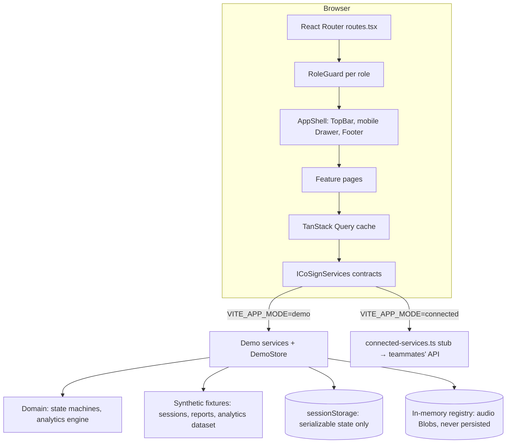
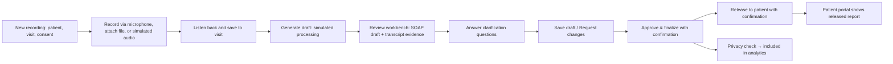

# CoSign frontend architecture

CoSign (AI for Clinical Documentation and Healthcare Analytics) is a Purdue University Fort Wayne capstone. This document describes the React frontend as it exists now. The backend, real transcription, AI agents, and database belong to teammates; the frontend runs on a local demo service layer with synthetic data until those services exist.

## Technology stack

| Concern | Choice |
|---|---|
| UI | React 19, TypeScript 6 |
| Build / dev server | Vite 8 |
| Routing | React Router 7 (`createBrowserRouter`) |
| Server state | TanStack Query 5 |
| Styling | Tailwind CSS 4 + design tokens in `src/design-system/tokens.css` |
| Accessible primitives | Radix UI (dialog, drawer) |
| Icons | lucide-react |
| Validation | Zod (environment config) |
| Tests | Vitest 5, Testing Library, jsdom |
| Charts | Hand-built SVG components (no chart library dependency) |

## Architecture diagram



## Folder organization

```
src/
  app/                 providers (services, auth, query), router, shared query keys
  config/              env parsing, clinic clock (reference date 2026-10-06)
  design-system/       tokens, layouts (AppShell, TopBar, Sidebar, Footer), shared components
    components/charts/ ColumnChart, LineChart, BreakdownTable, chart-utils
  domain/              models, state machines (clinical safety rules), analytics aggregation
  features/
    auth/              role selection (login)
    clinician/         dashboard, sessions, recording, review workbench, review queue, visit subpages
    analytics/         analytics page + URL filter mapping
    patient/           patient portal list and detail
    admin/             administration (overview, users & access, audit log)
    settings/          workspace preferences
  services/
    contracts/         ICoSignServices interfaces (the agreement with the backend)
    demo/              demo implementation, store, fixtures
    api/               connected-mode stub
```

Pages never import the demo store directly. They call `useServices()` and receive whichever implementation of `ICoSignServices` the app is running with.

## Routing structure

| Route | Screen | Roles |
|---|---|---|
| `/login` | Role selection | all |
| `/clinician/dashboard` | Dashboard | clinician |
| `/clinician/sessions` | Clinical sessions list (search, filter, sort) | clinician |
| `/clinician/sessions/new` | New recording | clinician |
| `/clinician/sessions/upload` | New recording, file mode | clinician |
| `/clinician/sessions/:id/record` | Record an existing visit | clinician |
| `/clinician/sessions/:id` | Review workbench | clinician |
| `/clinician/sessions/:id/summary` | Visit summary | clinician |
| `/clinician/sessions/:id/history` | Report history and activity log | clinician |
| `/clinician/sessions/:id/privacy` | Analytics privacy check | clinician |
| `/clinician/reviews` | Reports & review queue | clinician |
| `/clinician/analytics?view=cohort\|monthly` | Healthcare analytics | clinician |
| `/analyst/analytics?view=cohort\|monthly` | Healthcare analytics | analyst |
| `/patient`, `/patient/reports`, `/patient/reports/:id`, `/patient/history` | Patient portal | patient |
| `/admin?tab=overview\|users\|audit` | Administration | admin |
| `/settings` | Settings | clinician, admin |
| `*` | Not found page with a link to the role's home | all |

Every route renders a working screen. The earlier `SequencePlaceholderPage` was removed.

## Role-based navigation

Navigation items are defined once in `ROLE_NAV_ITEMS` (`src/design-system/layouts/Sidebar.tsx`) and reused by the desktop top bar, the mobile drawer, and the footer, so a role only ever sees links it can open.

| Role | Navigation |
|---|---|
| Clinician | Dashboard, Clinical sessions, Reports & review, Analytics, Settings, plus a green **New recording** button |
| Patient | Overview, My reports, Visit history |
| Analyst | Population overview, Monthly operations |
| Administrator | Overview, Users & access, Audit log, Settings |

`isNavItemActive` picks the single best match for the current URL, so exactly one item is marked `aria-current="page"` (for example, "New recording" rather than "Clinical sessions" on `/clinician/sessions/new`).

If someone types a URL their role cannot open, `RoleGuard` shows an "Access restricted" page with "Go to my workspace", "Switch demo role", and "Return to role selection". No content from the protected page renders.

The utility bar's "Demo role:" buttons are an explicit demo role switcher, labeled as such.

## State and data flow

1. A page calls a service through TanStack Query (`useQuery`) or directly for mutations.
2. The demo service validates the action with the domain state machine and updates `DemoStore`.
3. `DemoStore` saves serializable state to `sessionStorage` and notifies subscribers.
4. After any clinical mutation, pages call `invalidateWorkspaceQueries()` (`src/app/query-keys.ts`), which refreshes every cache key that depends on session state (dashboard, lists, review queue, patient portal, analytics). Earlier code refreshed a `['sessions']` key that no screen used.

Filters on the sessions list and analytics pages live in the URL, so views can be bookmarked and the back button works.

## Demo service architecture

`createDemoServices(store)` implements every contract in `src/services/contracts/index.ts`:

| Service | Demo behavior |
|---|---|
| `sessions` | Lists and creates sessions, computes dashboard metrics from the store |
| `capture` | Saves recording metadata; audio Blobs stay in an in-memory registry and are never uploaded or persisted |
| `processing` | Simulates the pipeline. New visits receive a **simulated draft built for their own patient** (`fixtures/simulated-draft.ts`). Seeded visits keep their canonical drafts. Retries are limited by `maxRetries` |
| `review` | Save, edit, clarify, request changes, approve, release, all through the state machine |
| `privacy` | Simulated two-pass de-identification check |
| `patientPortal` | Returns only released reports for the signed-in patient, with internal notes stripped |
| `analytics` | Aggregates a deterministic synthetic dataset through `domain/analytics` |
| `admin` | Audit log and preferences |

**Reset:** "Reset demo state" in the green notice bar restores the canonical seed and clears in-memory audio.

## Clinical workflow



Safety rules enforced by `src/domain/state-machines/index.ts` and unchanged by this work:

- Only the assigned clinician can edit, approve, or release.
- Approval is blocked while clarification questions are open or edits are unsaved.
- Every write passes `expectedRevision`; a stale revision is rejected.
- Patients see a report only when it is both approved and released.

One change was made in the domain layer: answering clarifications used to swap in fixed metformin text. It now appends exactly what the clinician typed to the Plan section.

## Recording implementation

`ClinicalVisitCapturePage.tsx` (the interrupted Sequence 4A work) was kept and connected rather than rewritten. It uses `navigator.mediaDevices.getUserMedia`, `enumerateDevices`, and `MediaRecorder` with pause/resume, a level meter, and a leave-page guard. Changes:

- Routed at `/clinician/sessions/new`, `/upload`, and `/:id/record`.
- Fixed the three lint errors.
- Removed a fake placeholder Blob; empty or sub-second recordings now show "The recording was empty" with a retry.
- Added "No microphone? Use simulated demo audio" for demos without a microphone.
- Added "Generate draft and review", which starts simulated processing and opens the review page.
- Simplified wording. In demo mode nothing is uploaded; audio stays in tab memory.

Handled failures: permission denied, no microphone, insecure context, unsupported browser or codec, device disconnected mid-recording, recorder error, empty audio, unsupported or oversized file, interrupted upload with retry.

## Analytics implementation

- **Dataset:** `generateSyntheticAnalyticsDataset()` creates about 900 de-identified visit records from Jan 5 to Oct 6, 2026, using a fixed seed so every demo shows identical numbers. Records carry only coarse categories (department, diagnosis, symptom, age band, sex, status).
- **Engine:** `computeAnalyticsSummary()` in `src/domain/analytics` derives every KPI, chart, and table from the same filtered records, so totals always agree.
- **Two views:**
  - *Population overview* uses only completed, privacy-verified visits by default, with small-cell suppression (counts of 1 to 4 hidden).
  - *Monthly operations* shows operational counts (sessions, completed, awaiting review, completion rate, median review time). These are not population statistics.
- **Filters:** date range (presets and custom), month and year, diagnosis, department, age group, sex, report status, and "include unverified visits". Apply and Reset buttons, removable filter chips, previous/next month.
- **Charts:** SVG column and line charts with hover tooltips, axis labels, units, a legend for multi-series, and a "Show data table" toggle. Breakdowns are real tables. The two-series palette (`#00783c`, `#8a4fc9`) passed a colour-vision-deficiency check.

The `AnalyticsSummaryResponse` contract gained fields for these screens (`monthlyKpis`, `monthlyTrend`, breakdowns, `availableMonths`) and `AnalyticsFilterCriteria` gained `ageGroup`, `sex`, `reportStatus`. Teammates' analytics endpoint should return the same shape.

## Integration boundaries

- `ICoSignServices` and the domain models are the contract. Backend work replaces `services/api/connected-services.ts`; pages do not change.
- Server-side enforcement still needed (frontend checks are for UX only): role and ownership on every write, consent before capture, patient-scoped queries, and small-cell suppression in analytics.
- Real microphone capture exists in the browser. Uploading audio to a server, transcription, and AI drafting are not implemented.

## Security and accessibility considerations

- Only synthetic data. No real patient information anywhere.
- Audio Blobs are never written to storage; `assertSerializableDemoStateSafe` rejects any `blob:` URL in persisted state.
- The demo role switcher is not authentication.
- Accessibility work (target WCAG 2.2 AA): a skip link; visible focus outlines on every interactive element; a single `h1` per page; breadcrumbs with `aria-current`; labelled form controls; Radix dialogs with focus trapping; `role="alert"` and `aria-live` for errors and progress; status badges always include text and an icon, not colour alone; charts have text descriptions and table views; `prefers-reduced-motion` disables animation; layouts were checked at 375px with no horizontal scrolling.

## Implemented versus future

| Implemented (frontend, demo data) | Future (backend / teammates) |
|---|---|
| All screens and routes listed above | Real authentication and server authorization |
| Browser microphone capture, local playback | Audio upload, storage, normalization |
| Simulated processing and drafts, clearly labeled | Speech transcription and AI drafting |
| Review, clarification, approval, release flows | Persistent database |
| Interactive analytics on synthetic data | Analytics API over real de-identified data |
| Simulated privacy check | Real de-identification pipeline |
